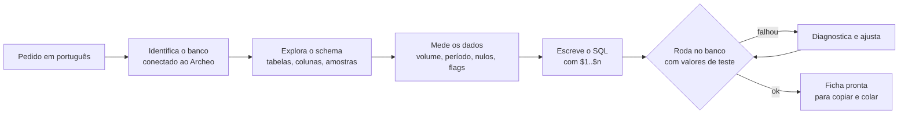

<div align="center">

# Archeo Claude Plugins

**Do banco legado ao painel executivo e às ferramentas de IA, com cada número conferido no seu banco.**

[](LICENSE)
[](#instalação)
[](https://cd2tec.github.io/archeo-claude-plugins/)
[](#bancos-suportados)

**[Conheça o site do plugin →](https://cd2tec.github.io/archeo-claude-plugins/)**

</div>

---

O [Archeo](https://github.com/cd2tec) conecta bancos de dados legados a assistentes de IA. Com o **Archeo MCP Creator**, cada consulta vira uma ferramenta que o modelo pode chamar: um SELECT fixo, com parâmetros, que o servidor valida antes de aceitar.

Este repositório reúne plugins para o Claude que tiram o trabalho braçal desse processo:

- **`add-mcp-tool`** transforma uma pergunta de negócio em ferramenta pronta para cadastrar no MCP Creator.
- **`add-mcp-dashboard`** monta um painel executivo de varejo direto do ERP conectado, em snapshot, ao vivo ou com atualização agendada.
- **`analyze-mcp-*`** gera os relatórios de um ERP de varejo (estoque, vendas, compras, preços, perdas, fiscal, contábil e financeiro), cada um com sua prova de reconciliação.

## O problema

Cadastrar uma boa ferramenta não é só escrever um SELECT. Você precisa:

- achar a tabela ou view certa num schema que ninguém documentou;
- descobrir quais registros excluir (cancelados, estornados, marcados para expurgo);
- transformar filtros em parâmetros `$1`, `$2`, ... com o tipo certo;
- escrever uma descrição que outro modelo de IA entenda sem ambiguidade;
- testar tudo antes de publicar.

Um detalhe errado não dá erro. A ferramenta simplesmente **devolve zero linhas, ou um número inflado, e ninguém percebe**.

## A solução: `add-mcp-tool`

Você descreve o que quer em português. O Claude explora o banco conectado ao Archeo, escreve o SQL, roda no banco real e devolve a ficha pronta para copiar e colar na tela **Nova ferramenta**.

```
Você: crie uma ferramenta no Archeo para vendas por loja e mês, com filtro de período e loja

Claude: [identifica o banco conectado, procura colunas de venda, data e loja,
         confere cancelamentos e nulos, escreve o SQL, roda com valores de teste]

        Banco: loja_demo (SQL Server 16.0)

        | Nome técnico  | pdv_venda_resumo_loja_mes |
        | Schema        | dbo                       |
        | Descrição     | Venda bruta, descontos, venda líquida e ticket médio por
                          loja e mês, sem cupons cancelados. $1 = data inicial ... |

        SQL, parâmetros com tipos, limites e resultado esperado do teste ...
```

Veja uma ficha completa em [`exemplo-ficha.md`](plugins/archeo/skills/add-mcp-tool/references/exemplo-ficha.md).

## Como funciona



## O que vem na ficha

| Campo | O que a skill entrega |
|---|---|
| **Nome técnico** | `snake_case` com prefixo do sistema, sem colisão entre bancos |
| **Nome de exibição** | Rótulo curto em português |
| **Descrição** | Escrita para o modelo que vai chamar a ferramenta: o que retorna, cada parâmetro, convenções |
| **Schema** | O schema certo para o dropdown |
| **SQL** | Um único SELECT no dialeto do seu banco, com parâmetros posicionais |
| **Parâmetros** | Nome, tipo (`date`, `integer`, `string`...) e obrigatoriedade de cada `$n` |
| **Limites** | Linhas, bytes e timeout dimensionados para a consulta |
| **Teste** | Valores de entrada e o resultado esperado, para conferir depois de salvar |
| **Premissas** | Regras de negócio assumidas e qualquer ajuste aplicado |

## Boas práticas embutidas

A skill aplica, por padrão, regras que evitam os erros silenciosos mais comuns:

- **Datas com fim exclusivo** (`>= início AND < fim`), sem perder o último dia nem matar o índice.
- **"Todos" sem armadilha**: o filtro opcional usa um valor sentinela (`0 = todas as lojas`) e não devolve zero linhas quando o parâmetro chega vazio.
- **Somas à prova de nulo**: `COALESCE` dentro de expressões compostas, para um campo vazio não zerar o total.
- **Tipos como contrato**: o tipo do parâmetro na tela valida a entrada antes de chegar no banco.
- **Validação obrigatória**: nenhuma ficha sai sem ter rodado no banco conectado, em pelo menos dois cenários. Quando não dá para validar, a ficha avisa com destaque.

## Painel de varejo: `add-mcp-dashboard`

Peça um painel e receba um artefato pronto para abrir, com os números do ERP ou PDV conectado ao Archeo:

| Bloco | O que mostra |
|---|---|
| **Totalizadores** | Venda líquida, cupons, ticket médio, itens por cupom, desconto, cancelamentos, margem e clientes identificados, com variação contra o período anterior |
| **Índice de saúde (0 a 100)** | Um número com a decomposição por componente: crescimento, ticket, desconto, cancelamento, margem e identificação de clientes |
| **Linha do tempo** | Venda por dia, período atual contra o anterior alinhado |
| **Mapa de calor** | Venda por dia da semana e hora, para escala de equipe e abastecimento |
| **Rankings** | Departamentos, produtos, meios de pagamento, lojas e operadores (descontos e cancelamentos) |
| **Curva ABC** | Quantos SKUs fazem 80% da venda |
| **Leitura** | De 3 a 6 alertas em linguagem de negócio, do mais urgente ao menos |

O painel não esconde dado ruim: seção sem dado confiável sai do painel e aparece no rodapé com o motivo. A skill reconcilia cada ranking com a venda total, detecta custo estimado (margem idêntica em todos os departamentos), campo nunca preenchido e período anterior sem base de comparação.

```
Você: monta um dashboard da operação dos últimos 30 dias

Claude: [mapeia venda, itens, cadastros, pagamento, custo e estoque no banco conectado,
         calcula e reconcilia cada seção, escreve a leitura, publica o painel]
```

Três modos de atualização:

| Modo | Para quem | Como atualiza |
|---|---|---|
| **Snapshot** | Relatório de período fechado, qualquer pessoa com o link | Republicando |
| **Ao vivo** | Quem tem o conector Archeo no Claude | A página consulta o banco ao abrir e a cada 5 minutos |
| **Agendado** | Diretoria sem conector | Uma tarefa agendada roda a skill e republica, por exemplo todo dia às 6h |

## Relatórios de ERP: `analyze-mcp-*`

Peça o relatório pelo nome que você já usa no ERP. A skill do módulo localiza os dados no banco conectado, mede a qualidade, calcula e **prova** o resultado antes de entregar.

| Skill | Você pede | Ela entrega |
|---|---|---|
| `analyze-mcp-estoque` | "Kardex do produto 1234 em julho" | Movimentação com saldo acumulado, conferida contra o saldo atual |
| `analyze-mcp-vendas` | "curva ABC de venda do trimestre" | Classes A, B e C com participação e acumulado, somando a venda total |
| `analyze-mcp-compras` | "sugestão de compra do fornecedor X" | Demanda, saldo, pendente e sugestão por embalagem, em planilha editável |
| `analyze-mcp-precos` | "o que estou vendendo abaixo do custo?" | Itens com margem negativa, depois do teste de confiabilidade do custo |
| `analyze-mcp-perdas` | "quebras por motivo e setor" | Perda identificada e não identificada, a custo e sobre a venda |
| `analyze-mcp-fiscal` | "documentos fiscais por CFOP do mês" | Sintético por operação, com conferência de cabeçalho contra itens |
| `analyze-mcp-contabil` | "balancete de julho" | Saldo anterior, débitos, créditos e saldo atual, com débito = crédito |
| `analyze-mcp-financeiro` | "títulos vencidos e fluxo dos próximos 30 dias" | Aging e projeção, separando realizado, previsto e não incluído |

Três regras valem para todas:

- **Relatório sem prova não sai.** Kardex fecha com o saldo, balancete fecha débito com crédito, ABC soma a venda total. O que não fecha vira o primeiro item da entrega.
- **Dado ruim aparece.** Custo estimado, campo nunca preenchido, módulo sem uso e posição desatualizada são achados, não rodapé.
- **Fiscal e contábil são conferência gerencial.** Não substituem escrituração, livros oficiais nem apuração.

O relatório que você vai pedir de novo vira ferramenta: cada skill indica os parâmetros e passa para `add-mcp-tool` o SQL já validado.

## Bancos suportados

| Engine | Status |
|---|---|
| SQL Server | Validado contra banco real |
| PostgreSQL | Suportado, sintaxe padrão a confirmar no primeiro uso |
| Oracle | Suportado, sintaxe padrão a confirmar no primeiro uso |
| MySQL / MariaDB | Suportado, sintaxe padrão a confirmar no primeiro uso |

Em qualquer engine, a palavra final é do teste no banco conectado: se algo não roda, a skill diagnostica e ajusta antes de entregar.

## Instalação

No Claude Code:

```
/plugin marketplace add cd2tec/archeo-claude-plugins
/plugin install archeo@archeo-plugins
```

**Requisito:** um conector do Archeo ativo na sessão, com as ferramentas de consulta somente leitura (`db_*`). Sem ele, a skill avisa e só monta a ficha se você fornecer a estrutura das tabelas, marcada como não validada.

Depois de instalar, é só pedir:

- *"crie uma ferramenta no Archeo para títulos vencidos por cliente"*
- *"transforma essa query em ferramenta do MCP Creator"*
- *"quais tipos uso nos parâmetros dessa ferramenta?"*
- *"monta um dashboard da rede dos últimos 30 dias"*
- *"quero um painel ao vivo da loja 3 para acompanhar a semana"*
- *"me dá o Kardex do produto 1234 no último mês"*
- *"balancete de julho no nível 3"*
- *"o que comprar do fornecedor X para a loja 2?"*

## Segurança

- A skill **só lê**. Toda exploração e validação usa as ferramentas somente leitura do conector.
- O SQL gerado é sempre **um único SELECT**, sem escrita e sem identificador vindo de parâmetro, o mesmo que o validador do Archeo exige.
- Nada é cadastrado automaticamente: você revisa a ficha e decide o que publicar.

## Plugins

| Plugin | Skills | Para quê |
|---|---|---|
| [`archeo`](plugins/archeo) | `add-mcp-tool`, `add-mcp-dashboard`, `analyze-mcp-estoque`, `-vendas`, `-compras`, `-precos`, `-perdas`, `-fiscal`, `-contabil`, `-financeiro` | Criar ferramentas no Archeo MCP Creator, painéis de varejo e relatórios de ERP a partir do banco conectado |

## Contribuindo

Encontrou uma engine com comportamento diferente, ou um caso que a skill não cobre? Abra uma issue com a engine, a versão e a consulta. Pull requests são bem-vindos.

## Licença

[MIT](LICENSE), por [CD2 Retail Tech](https://github.com/cd2tec).
